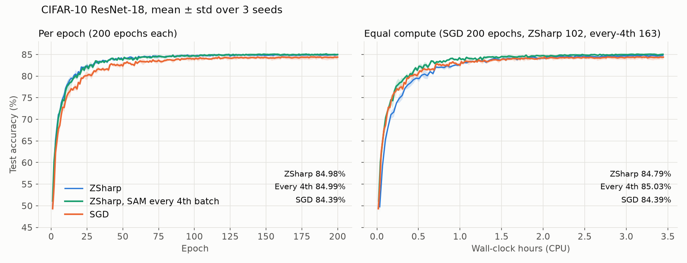

# ZSharp

[](https://colab.research.google.com/github/bangyen/zsharp/blob/main/zsharp_demo.ipynb)
[](https://github.com/bangyen/zsharp/actions/workflows/ci.yml)
[](LICENSE)

**Sharpness-Aware Minimization with Z-Score Gradient Filtering: beats SGD per epoch (+2.65% at 20 epochs, +0.59% at 200 on CIFAR-10), but each epoch costs ~1.9x. Taking the SAM step every 4th batch cuts that to ~1.1–1.3x and keeps most of the gain, so it matches or beats SGD at equal compute on CIFAR-10 and CIFAR-100. Fully reproducible.**

<p align="center">
  
</p>

## Quickstart

Clone the repo and run the demo:

```bash
git clone https://github.com/bangyen/zsharp.git
cd zsharp
pip install -e .
pytest   # optional: run tests
python -m scripts.train --config configs/zsharp_baseline.yaml
python -m scripts.train --config configs/zsharp_fast.yaml   # SAM step every 4th batch
```

Or open in Colab: [Colab Notebook](https://colab.research.google.com/github/bangyen/zsharp/blob/main/zsharp_demo.ipynb).

## Results

| Scenario / Dataset | Epochs | Baseline (SGD) | This Project | Δ Improvement |
|--------------------|--------|----------------|--------------|---------------|
| CIFAR-10 ResNet-18 | 20     | 78.19 ± 0.23%  | **80.84 ± 0.54%** | +2.65%   |
| CIFAR-10 ResNet-18 | 50     | 82.36 ± 0.88%  | **83.81 ± 0.18%** | +1.45%   |
| CIFAR-10 ResNet-18, strong reg.† | 50 | 80.18 ± 0.08% | **83.49 ± 0.30%** | +3.31% |
| CIFAR-10 ResNet-18 | 200    | 84.39 ± 0.48%  | **84.98 ± 0.36%** | +0.59%   |
| CIFAR-10 ResNet-18, strong reg.† | 200 | 85.62 ± 0.34% | **86.38 ± 0.43%** | +0.76% |
| CIFAR-100 ResNet-18 | 20 | 48.59 ± 0.51% | **50.75 ± 0.49%** | +2.16% |
| CIFAR-100 ResNet-18 | 50 | 51.99 ± 0.51% | **52.12 ± 0.41%** | +0.13% |
| CIFAR-100 ResNet-18, strong reg.† | 50 | 52.39 ± 0.53% | **54.85 ± 0.27%** | +2.46% |

*Final test accuracy, mean ± std over 3 seeds (42, 1, 2). 200 epochs:
`python -m scripts.sweep --epochs 200 --seeds 42 1 2 [--regularize]`. The
50-epoch rows are epoch 50 of those runs, which match a 50-epoch run exactly
since the LR schedule does not depend on the total. Baseline:
`configs/sgd_baseline.yaml`. ZSharp:
`configs/zsharp_baseline.yaml` (paper hyperparameters: AdamW, batch size 256,
$Q_p = 0.95$), with `epochs` set as shown. Measured on CPU.
† `label_smoothing: 0.1` and `strong_augmentation: true` (TrivialAugmentWide
plus random erasing). Both models underfit at 50 epochs under this
regularization (~70% train accuracy), so it lowers accuracy for both, but
the per-epoch gap widens; by 200 epochs it raises both (+1.2% SGD, +1.4%
ZSharp) and ZSharp leads on every seed. CIFAR-100:
`python -m scripts.sweep --configs configs/sgd_cifar100.yaml
configs/zsharp_cifar100_baseline.yaml --epochs {20,50} --seeds 42 1 2 [--regularize]` (same
hyperparameters, `dataset: cifar100`).*

> **Note**: the gap shrinks with training — ZSharp reaches its plateau
> sooner, but both end within about a point. Each ZSharp step costs two
> forward/backward passes plus the Z-score filtering; one ZSharp epoch takes
> ~2x as long as an SGD epoch (121 s vs 62 s on 4 CPU threads). Given the
> same compute as 200 SGD epochs, 102 ZSharp epochs reach 84.79 ± 0.36% vs
> SGD's 84.39 ± 0.48% (last-10-epoch means 84.74% vs 84.35%; ZSharp ahead on
> every seed). SGD leads for roughly the first 30% of that budget; see the
> right panel of the figure above. With strong regularization the
> equal-compute result is 86.04 ± 0.40% vs 85.62 ± 0.34%. A 200-epoch ZSharp
> run takes ~5.7 h at the current per-epoch cost. On CIFAR-100 the
> equal-compute picture reverses: 20 SGD epochs buy ~11 ZSharp epochs
> (1.9x cost), which reach 47.68 ± 0.37% vs SGD's 48.59 ± 0.51%; at 50 SGD
> epochs, ~27 ZSharp epochs reach 51.47 ± 0.10% vs 51.99 ± 0.51%; with strong
> regularization, ~27 ZSharp epochs reach 49.77 ± 0.59% vs 52.39 ± 0.53%.
>
> **Cheaper SAM steps** (`optimizer.sam_interval: k`): take the two-pass SAM
> step only every k-th batch and a plain AdamW step otherwise. CIFAR-10,
> 20 epochs, 3 seeds:
>
> | Optimizer | Accuracy | s/epoch | At SGD's 20-epoch time |
> |---|---|---|---|
> | SGD | 78.19 ± 0.23% | 68 | 78.19 ± 0.23% |
> | ZSharp, k=1 | 80.84 ± 0.54% | 127 | — |
> | ZSharp, k=2 | 80.59 ± 0.28% | 88 | 79.10 ± 0.93% |
> | ZSharp, k=4 | 80.41 ± 0.57% | 76 | 80.12 ± 0.61% |
> | ZSharp, k=8 (5 seeds) | 80.05 ± 1.05% | 69 | ≈ 80.05% (same cost as SGD) |
> | ZSharp, k rising 2→8 | 80.51 ± 0.28% | 81 | 80.04 ± 0.47% |
>
> The rising interval (`optimizer.sam_interval_final: 8` with
> `sam_interval: 2`) moves k linearly over training. It edges out fixed k=4 on
> accuracy but not at equal compute.
>
> At 200 epochs (`configs/zsharp_fast.yaml`, 3 seeds), k=4 reaches
> 84.99 ± 0.23% at 76 s/epoch, matching k=1 (84.98 ± 0.36%); at SGD's
> 200-epoch time (~163 epochs) it reaches 85.03 ± 0.28% vs SGD's
> 84.39 ± 0.48%.
>
> With `--regularize`, k=4 reaches 86.50 ± 0.15% at 86 s/epoch (k=1:
> 86.38 ± 0.43%; SGD: 85.62 ± 0.34%); at regularized SGD's 200-epoch time
> (~174 epochs) it reaches 86.57 ± 0.30%, vs k=1's 86.04 ± 0.40%.
>
> On CIFAR-100 (20 epochs, 3 seeds), k=4 reaches 50.40 ± 0.55% at 78 s/epoch
> (SGD 48.59 ± 0.51% at 74 s, ZSharp k=1 50.75 ± 0.49% at 140 s); at SGD's
> 20-epoch time it reaches 50.35 ± 0.38%, reversing the equal-compute loss.
> At 50 epochs k=4 reaches 51.97 ± 0.61% (80 s/epoch), and 51.95 ± 0.48% at
> SGD's time, a tie with SGD's 51.99 ± 0.51%. With strong regularization it
> reaches 55.07 ± 0.53% (88 s/epoch), and 53.75 ± 0.31% at SGD's time vs
> SGD's 52.39 ± 0.53%.

## Features

- **Z-Score Gradient Filtering** — Layer-wise Z-score normalization with a global 95th percentile threshold (configurable), matching the paper's $Q_p = 0.95$.
- **Device Support** — Runs on CUDA, Apple Silicon (MPS) or CPU, with optional half precision on MPS.
- **Paper Architectures** — CIFAR-style ResNet-56/110, VGG-16BN, and the paper's compact ViTs, on CIFAR-10/100 and Tiny-ImageNet.
- **Comprehensive Testing** — 95%+ test coverage with 156 tests ensuring reliability and reproducibility.

## Repo Structure

```plaintext
zsharp/
├── zsharp_demo.ipynb  # Colab notebook demo
├── scripts/           # Training and experiment scripts
├── tests/             # Unit/integration tests (143 tests)
├── docs/              # Documentation and training curves
├── configs/           # Configuration files
├── results/           # Experimental results
└── zsharp/               # Core implementation
```

## Validation

- ✅ 95%+ test coverage (`pytest`)
- ✅ Reproducible seeds for experiments
- ✅ Benchmark scripts included

## References

- [Sharpness-Aware Minimization with Z-Score Gradient Filtering](https://arxiv.org/html/2505.02369v3) — Original research paper by Juyoung Yun. The optimizer and default hyperparameters follow this paper: $Q_p = 0.95$, $\rho = 0.05$, AdamW base optimizer (lr 1e-3, weight decay 5e-5), and an LR step decay of 0.75 every 10 epochs.
- [Sharpness-Aware Minimization](https://arxiv.org/abs/2010.01412) — Foundation SAM algorithm research.

## License

This project is licensed under the [MIT License](LICENSE).
